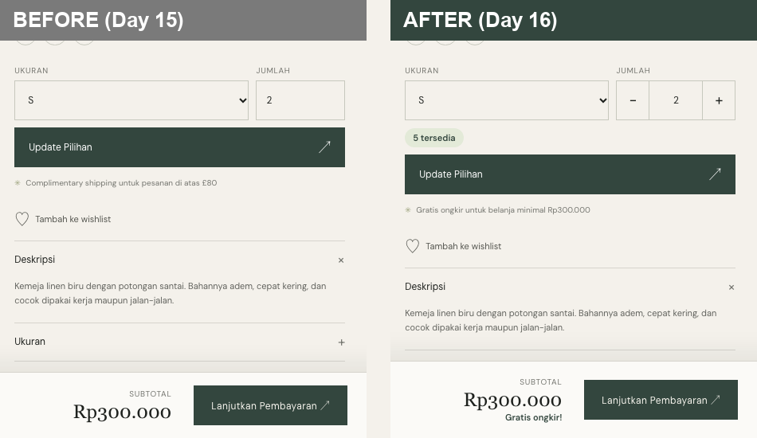
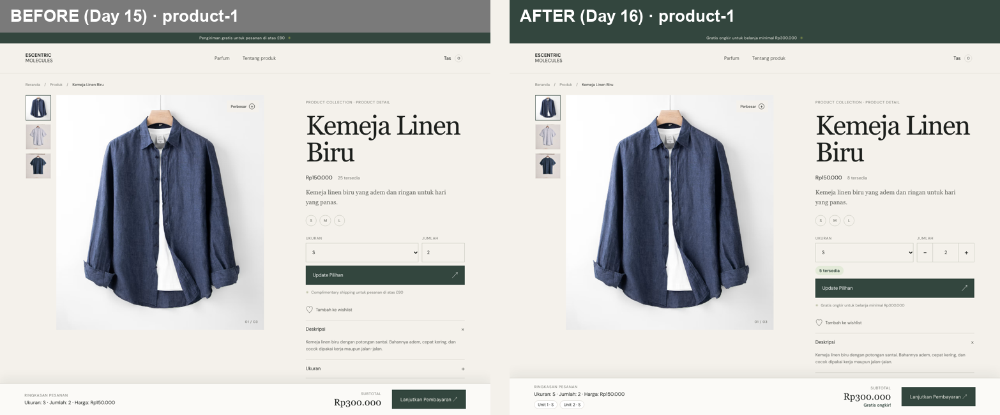
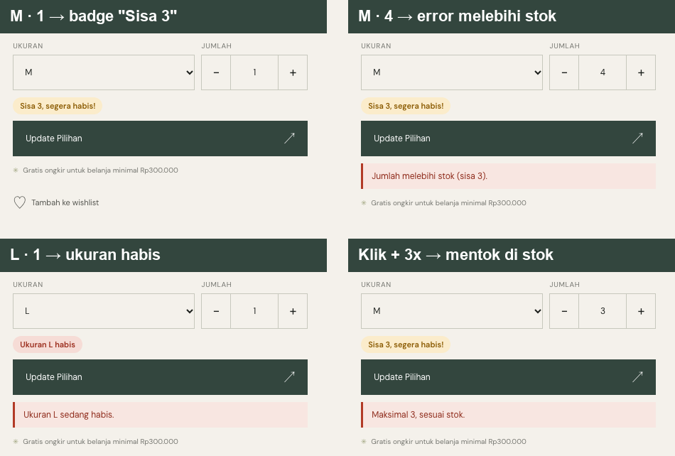
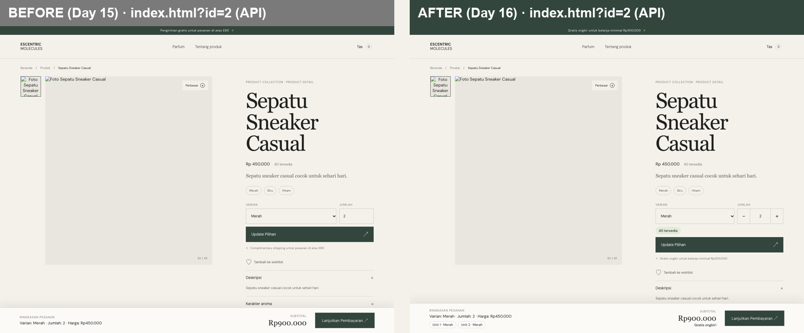
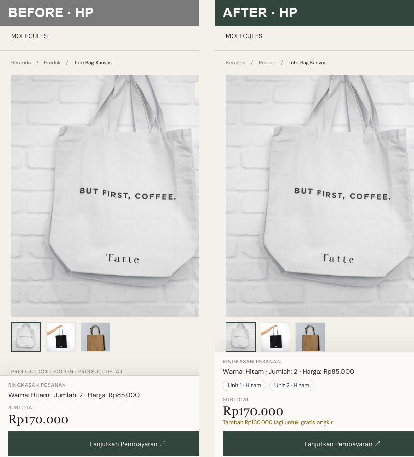

# Panduan Website Day 16: Halaman Produk yang Bisa Ambil Keputusan

> Lanjutan dari checkpoint Day 15 (22 Oktober 2026). Isinya: apa yang berubah (before vs after), langkah membangunnya, dan prompt AI yang bisa dipakai student untuk tiap langkah.

---

## 1. Ringkasan singkat

**Fokus Day 16 adalah control flow:** `if / else if / else`, `switch`, `for`, dan `while`. Bagian website tetap **overview** (demo mentor), jadi student cukup paham *di mana* materi tadi dipakai.

Di Day 15, halaman produk cuma bisa **menghitung**: pilih varian dan jumlah, lalu subtotal muncul. Halaman itu belum bisa **memutuskan** apa pun. Pesan 4 padahal stok cuma 3 tetap lolos, dan ukuran yang habis tetap bisa dipesan.

Di Day 16, halaman yang sama sekarang bisa:

- **Tahu stok tiap varian** dengan `switch`.
- **Kasih label stok** (tersedia, sisa sedikit, habis) dengan `if / else if / else`.
- **Membatasi tombol − / +** sesuai stok dengan `if / else`.
- **Menolak pesanan yang salah** dan menampilkan pesan error yang jelas.
- **Memberi info gratis ongkir** dengan `if / else`.
- **Menampilkan rincian per unit** dengan `for` (versi `while` disiapkan sebagai komentar).

File yang berubah:

- `project-AI/product-interaction.js`: logika utama Day 16 (dipakai product 1, 2, dan 3).
- `project-AI/product-1.html`, `product-3.html`, `index.html`: form baru (stepper, badge stok, pesan error) dan rincian unit di footer bar.
- `project-AI/script.js`: halaman API (product 2) mengirim stok ke form, dan form dimatikan kalau stok 0.
- `project-AI/styles.css`: style untuk stepper, badge, pesan error, chip unit, dan info ongkir.
- `project-AI/frontend/` (admin Vite): label stok pakai `if / else if / else` + 1 test baru.
- `api-product/` (backend): **tidak berubah**. Database dan API tetap overview.

---

## 2. Before vs After

### Tampilan form (product 1)



**Before (Day 15)**
- Form cuma berisi dropdown ukuran, input angka jumlah, dan tombol **Update Pilihan**.
- Tidak ada info stok per ukuran. Halaman menulis "25 tersedia" untuk semua ukuran.
- Pesan 4 untuk ukuran yang stoknya 3 tetap menghasilkan subtotal.
- Ukuran L yang habis tetap bisa dipesan.
- Footer bar cuma berisi ringkasan dan subtotal.
- Teks ongkir masih bawaan template: "Complimentary shipping untuk pesanan di atas £80".

**After (Day 16)**
- Jumlah memakai **stepper − / +** yang mentok di stok varian yang dipilih.
- Setelah memilih ukuran, muncul **badge stok**: hijau "5 tersedia", kuning "Sisa 3, segera habis!", atau merah "Ukuran L habis".
- Pesanan yang salah ditolak dengan **pesan error merah** di bawah tombol, dan footer bar disembunyikan.
- Footer bar sekarang punya **chip per unit** (Unit 1 · S, Unit 2 · S) dan **info ongkir**.
- Teks ongkir disamakan ke rupiah: "Gratis ongkir untuk belanja minimal Rp300.000".
- Stok product 1 sekarang 8 (S 5, M 3, L 0), dan product 3 juga 8 (Putih 6, Hitam 2, Krem 0). Ini angka latihan, bukan data asli.

### Halaman penuh (product 1)



### Kondisi-kondisi baru



- **M · 1:** badge kuning "Sisa 3, segera habis!". Di footer bar muncul "Tambah Rp150.000 lagi untuk gratis ongkir".
- **M · 4:** pesan "Jumlah melebihi stok (sisa 3)." Footer bar tidak muncul.
- **L · 1:** badge merah "Ukuran L habis" dan pesan "Ukuran L sedang habis."
- **Klik + tiga kali dari 1:** angka berhenti di 3, lalu muncul "Maksimal 3, sesuai stok."

### Halaman API (product 2)



- **Before:** stok dari API cuma ditampilkan sebagai teks. Kalau stok 0, form tetap aktif (ada komentar `TODO(Day 16)`).
- **After:** stok API (`variants.quantity`) dikirim ke form lewat `data-stock`. Badge, stepper, dan validasi memakai stok asli dari database. Kalau stok 0, dropdown dan tombol **Update Pilihan** dimatikan dan teksnya "Stok habis".
- Foto produk 2 masih kosong karena data seed memakai URL `example.com`. Ini sama seperti di Day 15.

### Tampilan HP (product 3)



- Footer bar di HP sekarang memuat chip unit dan info ongkir, dan tetap tersusun ke bawah.

### Admin Vite (`localhost:5173`)

- **Before:** label stok cuma dua jalan: "Stok habis" atau "N tersedia".
- **After:** fungsi `stockLabel()` di `src/lib/product.js` punya tiga jalan dengan `if / else if / else`: "Stok habis" (merah), "Sisa N, segera habis" untuk stok 1 sampai 5 (oranye), dan "N tersedia".
- Ada 1 test baru di `tests/product.test.js`. Hasilnya 6/6 test lulus.

---

## 3. Langkah membangunnya, step by step

Semua langkah ada di `project-AI/product-interaction.js`, kecuali yang disebut lain.

### Step 0: Siapkan elemen HTML baru (di 3 halaman)
```html
<form id="productForm" class="product-form" novalidate>
  <label for="variant">Ukuran</label>
  <select id="variant">…</select>
  <label for="quantity">Jumlah</label>
  <div class="quantity-stepper">
    <button type="button" id="quantityMinus">−</button>
    <input id="quantity" type="number" min="1" step="1" value="1">
    <button type="button" id="quantityPlus">+</button>
  </div>
  <p class="stock-badge" id="stockBadge" hidden></p>
  <button class="add-button" type="submit">Update Pilihan</button>
  <p class="form-message" id="formMessage" role="alert" hidden></p>
</form>

<!-- di dalam footer bar -->
<ul class="unit-list" id="unitList"></ul>
<small class="shipping-info" id="shippingInfo"></small>
```
- `novalidate` dipasang karena sekarang **JavaScript kita** yang mengecek input, bukan pesan bawaan browser.
- Id lama dari Day 15 (`productForm`, `productPrice`, `variant`, `quantity`, `selectionSummary`) tidak berubah.

### Step 1: Stok per varian dengan `switch`
```js
function getStock(variant) {
  if (form.dataset.stock !== undefined) {
    return Number(form.dataset.stock);     // product 2: stok total dari API
  }
  let stock;
  switch (variant) {
    case 'S':
      stock = 5;
      break;
    case 'M':
      stock = 3;
      break;
    case 'L':
      stock = 0;
      break;
    // product 3: 'Putih' 6, 'Hitam' 2, 'Krem' 0
    default:
      stock = -1;                          // varian tidak dikenal
  }
  return stock;
}
```
- Satu nilai (`variant`) dicocokkan ke banyak pilihan pasti. Itu tugas `switch`.
- `break` wajib ada. Tanpa `break`, ukuran S ikut jatuh ke case M.
- `-1` dipakai sebagai tanda "varian tidak dikenal".
- Fungsi `getStock` disiapkan mentor karena stok dibutuhkan di tiga tempat (badge, stepper, submit). Fokus student tetap isi `switch`-nya.

### Step 2: Badge stok dengan `if / else if / else`
```js
if (variant === '') {
  stockBadge.hidden = true;
} else if (stock === -1) {
  stockBadge.textContent = 'Ukuran tidak dikenal';
} else if (stock === 0) {
  stockBadge.textContent = 'Ukuran ' + variant + ' habis';
} else if (stock <= 3) {
  stockBadge.textContent = 'Sisa ' + stock + ', segera habis!';
} else {
  stockBadge.textContent = stock + ' tersedia';
}
```
- Dijalankan setiap kali dropdown berubah (event `change`).
- Urutannya penting: `stock === 0` harus dicek **sebelum** `stock <= 3`. Kalau dibalik, stok 0 akan tertulis "Sisa 0".
- Kalau jumlah yang sudah diketik lebih besar dari stok varian baru, jumlah otomatis diturunkan ke stok.

### Step 3: Stepper − / + dengan `if / else`
```js
plusButton.addEventListener('click', () => {
  const quantity = Number(quantityInput.value);
  const stock = getStock(variantInput.value);
  if (variantInput.value === '') {
    showMessage('Pilih ukuran dulu.');
  } else if (stock === 0) {
    showMessage('Ukuran L sedang habis.');
  } else if (quantity >= stock) {
    showMessage('Maksimal ' + stock + ', sesuai stok.');
  } else {
    quantityInput.value = quantity + 1;
  }
});
```
- Tombol − sama polanya: `if (quantity > 1)` kurangi 1, `else` tampilkan "Jumlah minimal 1."
- Ini menggantikan stepper lama yang di Day 15 di-comment dengan `TODO(Day 16)`.

### Step 4: Validasi saat submit dengan `if / else if`
```js
let error = '';
if (variant === '') {
  error = 'Pilih ukuran dulu.';
} else if (stock === -1) {
  error = 'Ukuran tidak valid.';
} else if (!Number.isInteger(quantity) || quantity <= 0) {
  error = 'Jumlah harus bilangan bulat positif.';
} else if (!Number.isFinite(price) || price <= 0) {
  error = 'Harga produk belum tersedia.';
} else if (stock === 0) {
  error = 'Ukuran ' + variant + ' sedang habis.';
} else if (quantity > stock) {
  error = 'Jumlah melebihi stok (sisa ' + stock + ').';
}

if (error !== '') {
  showMessage(error);
  checkoutBar.hidden = true;
  return;                // berhenti: kode di bawahnya tidak jalan
}
```
- Yang pertama `true` menang, jadi urutannya dari yang paling dasar: varian, jumlah, harga, stok habis, lalu batas stok.
- `return` menghentikan seluruh listener. Subtotal, ongkir, dan daftar unit tidak dihitung kalau input salah.
- Kalau semua lolos, kode Day 15 (subtotal + ringkasan) jalan seperti biasa.

### Step 5: Info gratis ongkir dengan `if / else`
```js
if (subtotal >= 300000) {
  shippingInfo.textContent = 'Gratis ongkir!';
} else {
  const missing = 300000 - subtotal;
  shippingInfo.textContent = 'Tambah Rp' + missing.toLocaleString('id-ID') + ' lagi untuk gratis ongkir';
}
```
- Pola ini sama persis dengan Latihan 1 (Gratis Ongkir KebunSegar), cuma batasnya Rp300.000.
- Pakai `>=`, karena "minimal Rp300.000" berarti Rp300.000 pas juga gratis.

### Step 6: Rincian per unit dengan `for` (dan versi `while`)
```js
unitList.textContent = '';          // di awal submit: kosongkan daftar lama
for (let unit = 1; unit <= quantity; unit += 1) {
  const item = document.createElement('li');
  item.textContent = 'Unit ' + unit + ' · ' + variant;
  unitList.appendChild(item);
}
```
- Jumlah putarannya jelas (sebanyak `quantity`), jadi cocok pakai `for`.
- Versi `while` ada di file sebagai komentar. Pakai **salah satu** saja, dan jangan lupa `unit += 1` supaya loop berhenti.
- Loop jalan **setelah** validasi, jadi jumlah unit tidak pernah melebihi stok.

### Step 7: Halaman API (`script.js`)
```js
productForm.dataset.stock = maxQuantity;   // stok total dari API
if (maxQuantity === 0) {
  stockText.textContent = 'Stok habis';
  submitButton.disabled = true;
  variantInput.disabled = true;
} else {
  stockText.textContent = maxQuantity + ' tersedia';
  submitButton.disabled = false;
  variantInput.disabled = false;
}
```
- API kita cuma punya **satu stok total** per produk (`variants.quantity`), bukan stok per ukuran. Jadi di product 2, semua varian memakai stok total itu.
- Komentar `TODO(Day 16)` untuk stepper dan stok habis sudah dihapus karena sudah dikerjakan. *Add to bag* diberi label `TODO(nanti)`, karena butuh data keranjang (array/object).

### Step 8: Uji hasilnya

Product 1 (Kemeja Linen Biru, Rp150.000):
- Submit tanpa pilih ukuran → "Pilih ukuran dulu."
- S · 2 → badge "5 tersedia", subtotal **Rp300.000**, "Gratis ongkir!", 2 chip unit.
- M · 1 → badge "Sisa 3, segera habis!", subtotal Rp150.000, "Tambah Rp150.000 lagi untuk gratis ongkir".
- M · 3 → subtotal Rp450.000, 3 chip unit (pas di batas stok).
- M · 4 → "Jumlah melebihi stok (sisa 3).", footer bar hilang.
- L → badge "Ukuran L habis". Submit → "Ukuran L sedang habis."
- Jumlah 0, -1, atau 1.5 → "Jumlah harus bilangan bulat positif."
- Klik − saat jumlah 1 → "Jumlah minimal 1."
- Ganti value option jadi `XL` lewat DevTools → badge "Ukuran tidak dikenal", submit → "Ukuran tidak valid."

Product 3 (Tote Bag Kanvas, Rp85.000):
- Putih · 4 → Rp340.000, gratis ongkir, 4 chip.
- Hitam · 2 → Rp170.000, "Tambah Rp130.000 lagi untuk gratis ongkir".
- Krem → "Warna Krem habis".

Product 2 (`index.html?id=2`, dari API):
- Merah · 2 → Rp900.000 (harga dari database), gratis ongkir, 2 chip.
- Jumlah 41 (stok 40) → "Jumlah melebihi stok (sisa 40)."
- Kalau stok produk di database diubah jadi 0 lewat admin Vite → "Stok habis", dropdown dan tombol mati.

Semua tes di atas sudah aku jalankan di browser pada 23 Oktober 2026, dan tidak ada error di console.

---

## 4. Cara minta bantuan AI: prompt per langkah

### Rumus prompt (sama seperti Day 15)
1. **Peran:** AI berperan sebagai apa.
2. **Konteks:** project, file, dan kondisi sekarang (checkpoint Day 15).
3. **Tugas:** satu perubahan per prompt.
4. **Batasan:** apa yang tidak boleh diubah, dan batas materi (control flow saja, belum array/object).
5. **Format hasil:** kode per file, penjelasan, dan cara tes.

Tips Day 16:
- Sebutkan **urutan kondisi** yang kamu mau. AI sering menaruh cek batas stok sebelum cek stok habis.
- Minta AI menjelaskan **kapan loop berhenti** setiap kali ia menulis `for` atau `while`.
- Selalu tes angka batas sendiri: 0, 1, stok pas, dan stok + 1.
- Jangan tempel isi `.env` atau password ke AI.

### Prompt A: Pahami checkpoint Day 15 dulu
```
Kamu adalah mentor JavaScript yang sabar untuk pemula.
Ini lanjutan project halaman detail produk dari Day 15:
- product-1.html dan product-3.html: data hardcode di HTML
- index.html?id=2: data dari API localhost:3000 lewat script.js
- product-interaction.js: dipakai ketiga halaman, menghitung subtotal
Berikut isi product-interaction.js dan form di product-1.html: [tempel kode]

Jelaskan dengan bahasa sederhana:
1. Apa yang terjadi dari klik "Update Pilihan" sampai footer bar muncul.
2. Bagian mana yang ditandai TODO(Day 16) dan kenapa butuh if/else.
Jangan ubah kode apa pun dulu.
```

### Prompt B: Siapkan HTML baru
```
Kamu adalah front-end developer HTML/CSS dasar.
Konteks: di product-1.html, product-3.html, dan index.html ada <form id="productForm">
berisi select#variant, input#quantity, dan tombol submit. Di footer bar ada
<p id="selectionSummary"> dan <strong id="subtotalText">.

Tugas di ketiga halaman:
1. Bungkus input#quantity dengan tombol − (#quantityMinus) dan + (#quantityPlus).
2. Tambah <p id="stockBadge" hidden> di bawah select, dan
   <p id="formMessage" role="alert" hidden> di bawah tombol submit.
3. Di footer bar, tambah <ul id="unitList"> dan <small id="shippingInfo">.
4. Pasang novalidate di form, karena validasi akan dikerjakan JavaScript.
Batasan: jangan ganti id yang sudah ada dan jangan ubah tampilan lain.
Tambahkan style yang rapi di styles.css (badge hijau/kuning/merah, pesan error merah).
Hasil: potongan HTML per halaman + CSS yang ditambahkan.
```

### Prompt C: Stok per varian dengan switch
```
Kamu adalah mentor JavaScript (materi hari ini: if/else, switch, for, while).
Konteks: product-interaction.js dipakai product 1 (ukuran S/M/L) dan product 3
(warna Putih/Hitam/Krem). Product 2 dari API cuma punya satu stok total.

Tugas: buat function getStock(variant) yang:
- kalau form.dataset.stock ada, kembalikan Number(form.dataset.stock),
- selain itu pakai switch: S 5, M 3, L 0, Putih 6, Hitam 2, Krem 0,
- default mengembalikan -1 (varian tidak dikenal).
Batasan: pakai switch dengan break di tiap case (bukan object atau array).
Hasil: kodenya + jelaskan apa yang terjadi kalau satu break dihapus.
```

### Prompt D: Badge stok dan stepper
```
Konteks: product-interaction.js sudah punya getStock(variant).
Tugas:
1. Saat #variant berubah, tampilkan #stockBadge dengan if / else if / else:
   -1 -> "Ukuran tidak dikenal", 0 -> "Ukuran X habis" (merah),
   1 sampai 3 -> "Sisa N, segera habis!" (kuning), lainnya -> "N tersedia" (hijau).
   Kalau jumlah sekarang lebih besar dari stok, turunkan jumlahnya ke stok.
2. Tombol + menambah jumlah, tapi tidak boleh melebihi stok varian.
   Tombol − mengurangi jumlah, minimal 1. Kalau mentok, tampilkan pesan di #formMessage.
Batasan: cek stok 0 SEBELUM cek stok <= 3. Jangan pakai array atau object.
Hasil: kode + tabel kecil input dan hasil yang diharapkan untuk dites.
```

### Prompt E: Validasi submit
```
Konteks: listener submit di product-interaction.js dari Day 15 langsung menghitung
subtotal tanpa cek apa pun.
Tugas: sebelum menghitung, validasi dengan if / else if berurutan:
1. varian kosong -> "Pilih ukuran dulu."
2. getStock = -1 -> "Ukuran tidak valid."
3. jumlah bukan bilangan bulat positif -> "Jumlah harus bilangan bulat positif."
4. harga bukan angka positif -> "Harga produk belum tersedia."
5. stok 0 -> "Ukuran X sedang habis."
6. jumlah > stok -> "Jumlah melebihi stok (sisa N)."
Kalau ada error: tampilkan di #formMessage, sembunyikan #checkoutBar, lalu return.
Batasan: kode subtotal dan ringkasan dari Day 15 jangan diubah.
Hasil: listener lengkap + jelaskan kenapa urutannya seperti itu.
```

### Prompt F: Info ongkir dan rincian unit
```
Konteks: validasi submit sudah lolos dan subtotal sudah dihitung.
Tugas:
1. Dengan if / else: subtotal >= 300000 -> #shippingInfo "Gratis ongkir!",
   selain itu "Tambah RpX lagi untuk gratis ongkir" (format id-ID).
2. Dengan for: buat satu <li> per unit di #unitList, isinya "Unit 1 · S".
   Kosongkan #unitList di awal setiap submit.
3. Tulis juga versi while sebagai komentar, hasilnya harus sama.
Batasan: loop jalan SETELAH validasi. Jelaskan kapan for dan while berhenti.
Hasil: kode + cara mengetes dengan jumlah 1, 2, dan stok maksimal.
```

### Prompt G: Halaman API (product 2)
```
Konteks: script.js mengambil produk dari GET /api/products/:id. Stoknya ada di
product.variants.quantity (satu angka untuk semua varian).
Tugas: setelah data datang, simpan stok ke #productForm lewat dataset.stock.
Pakai if / else: kalau stok 0, tulis "Stok habis" dan matikan select dan tombol submit.
Kalau tidak, tulis "N tersedia" dan aktifkan keduanya.
Batasan: jangan buat variabel global yang namanya sama dengan di product-interaction.js.
Hasil: bagian script.js yang diubah + cara mengetes stok 0.
```

### Prompt H: Review dan checklist tes
```
Kamu adalah code reviewer. Ini product-interaction.js, script.js, dan form product-1.html
setelah Day 16: [tempel kode].
Review dengan checklist ini:
- Tiap case di switch punya break?
- Urutan if / else if benar (stok 0 dicek sebelum batas stok)?
- Loop pasti berhenti? Kapan kondisinya jadi false?
- Product 2 memakai harga dan stok dari API, bukan angka latihan?
- Ada error di console?
Jangan tulis ulang semuanya. Sebutkan masalah, lokasinya, dan saran singkat.
Lalu buatkan checklist tes manual untuk product 1, 2, dan 3.
```

### Prompt I (opsional): Label stok di admin Vite
```
Konteks: di project-AI/frontend/src/main.js, label stok ditulis dengan ternary
(stok 0 -> "Stok habis", selain itu "N tersedia").
Tugas: pindahkan ke function stockLabel(quantity) di src/lib/product.js dengan
if / else if / else: 0 -> "Stok habis", 1 sampai 5 -> "Sisa N, segera habis", lainnya -> "N tersedia".
Pakai di halaman daftar dan detail, dan tambah unit test di tests/product.test.js.
Hasil: kode per file + hasil npm test.
```

---

## 5. Cara menjalankan

```bash
# Terminal 1: database + API (folder api-product)
docker compose up -d
npm run dev                 # localhost:3000

# Terminal 2 (opsional): admin Vite (folder project-AI/frontend)
npm run dev                 # localhost:5173
npm test                    # 6 test lulus
```
- Buka `project-AI/product-1.html`, `product-3.html`, dan `index.html?id=2` dengan VS Code **Live Server** (`127.0.0.1:5500`).
- Foto Unsplash di product 1 dan 3 butuh internet.

---

## Ringkasan satu kalimat
**Day 15:** halaman produk bisa menghitung subtotal. **Day 16:** halaman yang sama sekarang bisa memutuskan (stok, validasi, ongkir) dengan `if/else` dan `switch`, lalu mengulang (rincian unit) dengan `for`.
